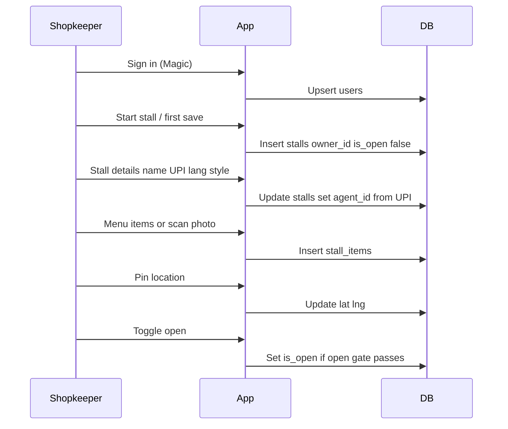

# Database — shop, menu, and bargains

Postgres holds people, their stall shell, the menu, and buyer bargains (offers + chat turns).

Migrations (apply with `npm run db:migrate`):

- [`0001_users_stalls.sql`](../db/migrations/0001_users_stalls.sql) — `users`, `stalls`
- [`0002_stall_items.sql`](../db/migrations/0002_stall_items.sql) — menu rows (`price` ask, `lowest` floor)
- [`0003_user_discovery.sql`](../db/migrations/0003_user_discovery.sql) — `users.discovery`
- [`0004_stall_device_status.sql`](../db/migrations/0004_stall_device_status.sql) — stall sign open/paused/closed
- [`0005_sign_claims.sql`](../db/migrations/0005_sign_claims.sql) / [`0006_sign_claim_secret.sql`](../db/migrations/0006_sign_claim_secret.sql) — ESP32 claim
- [`0007_bargains.sql`](../db/migrations/0007_bargains.sql) — `bargains`, `offers`, `turns`
- [`0008_one_deal_per_bargain.sql`](../db/migrations/0008_one_deal_per_bargain.sql) — at most one agreed/paid offer per bargain
- [`0009_offer_stall_hidden.sql`](../db/migrations/0009_offer_stall_hidden.sql) — shop can clear ended deals from their list (`offers.stall_hidden`)

## Purpose

A shopkeeper signs in, starts a stall a piece at a time (details → pin → open), and that state has to survive reloads. Step 1 answers: who is the person, and what is their stall shell?

## Decisions

| Decision              | Choice                                                                                                                                                                               |
| --------------------- | ------------------------------------------------------------------------------------------------------------------------------------------------------------------------------------ |
| Store                 | Postgres                                                                                                                                                                             |
| Stalls per shopkeeper | One (`stalls.owner_id` unique); drop uniqueness later if multi-stall is needed                                                                                                       |
| Person key            | Magic-style issuer string as `users.id`, plus `email`                                                                                                                                |
| Incomplete stalls     | Allowed; row can exist with empty name / no UPI / no pin                                                                                                                             |
| Discoverable          | Only when `is_open` is true                                                                                                                                                          |
| Agent address         | Nullable `agent_id` from UPI (`agent_` + first 10 hex of sha256(UPI)), unique when set — stall Agent Card at `/a2a/agents/{id}/.well-known/agent-card.json` (see [a2a.md](./a2a.md)) |
| Menu prices           | Whole rupees: `price` = starting ask, `lowest` = absolute floor (never told to buyers)                                                                                               |

## Entity model

```mermaid
erDiagram
  users ||--o| stalls : owns
  stalls ||--o{ stall_items : sells
  users ||--o{ bargains : starts
  bargains ||--o{ offers : asks
  stalls ||--o{ offers : answers
  stall_items ||--o{ offers : item
  offers ||--o{ turns : chat
  users {
    text id PK
    text email
    timestamptz created_at
  }
  stalls {
    text id PK
    text owner_id UK_FK
    text name
    text lang
    text style
    text upi_id
    text upi_qr
    text agent_id UK
    float lat
    float lng
    boolean is_open
    timestamptz created_at
    timestamptz updated_at
  }
  stall_items {
    int id PK
    text stall_id FK
    text name
    text words
    int price
    int lowest
    boolean active
  }
  bargains {
    uuid id PK
    text buyer_id FK
    text want
    text title
    int budget
    text buyer_lang
    timestamptz created_at
  }
  offers {
    uuid bargain_id PK_FK
    text stall_id PK_FK
    int item_id FK
    text status
    int asked
    int current
    int agent_offer
    int version
    timestamptz updated_at
  }
  turns {
    bigint id PK
    uuid bargain_id FK
    text stall_id FK
    text speaker
    text msg
    jsonb vars
    text text
    text status
    int current
    timestamptz at
  }
```

One user owns at most one stall. A stall has many menu items. A buyer bargain asks several stalls; each offer has a chat of turns.

## Tables

### `users`

One row per signed-in person. Upsert on sign-in.

| Column       | Type                                   | Notes                                                                 |
| ------------ | -------------------------------------- | --------------------------------------------------------------------- |
| `id`         | `text` PRIMARY KEY                     | Magic issuer (`did:ethr:0x…`)                                         |
| `email`      | `text` NOT NULL                        | Display / contact; updated on each sign-in                            |
| `discovery`  | `text` NOT NULL DEFAULT `'nearby'`     | Buyer find mode: `location` or `nearby` (Redis caches with short TTL) |
| `created_at` | `timestamptz` NOT NULL DEFAULT `now()` | First seen                                                            |

Buyers and shopkeepers share this table; owning a stall is what makes someone a shopkeeper. Discovery is read Redis → Postgres (on miss, fill Redis); writes go Postgres then Redis.

### `stalls`

The shopkeeper's stall shell. Progressive setup: create empty and closed, then fill details, pin, then open.

| Column       | Type                                           | Notes                                              |
| ------------ | ---------------------------------------------- | -------------------------------------------------- |
| `id`         | `text` PRIMARY KEY                             | Stable id (`u-` + short uuid)                      |
| `owner_id`   | `text` NOT NULL UNIQUE REFERENCES `users (id)` | One stall per shopkeeper                           |
| `name`       | `text` NOT NULL DEFAULT `''`                   | Empty until the shop names it                      |
| `lang`       | `text` NOT NULL                                | Stall speak language code (e.g. `en`, `hi`)        |
| `style`      | `text` NOT NULL DEFAULT `'friendly'`           | `friendly` or `firm` — agent tone later            |
| `upi_id`     | `text`                                         | VPA (`name@bank`); required before open            |
| `upi_qr`     | `text`                                         | Scanned `upi://` payload when it matches `upi_id`  |
| `agent_id`   | `text` UNIQUE                                  | Set when UPI is set; null while draft              |
| `lat`        | `double precision`                             | Null until pin; `CHECK (lat BETWEEN -90 AND 90)`   |
| `lng`        | `double precision`                             | Null until pin; `CHECK (lng BETWEEN -180 AND 180)` |
| `is_open`    | `boolean` NOT NULL DEFAULT `false`             | Closed / incomplete stalls are not discoverable    |
| `created_at` | `timestamptz` NOT NULL DEFAULT `now()`         |                                                    |
| `updated_at` | `timestamptz` NOT NULL DEFAULT `now()`         | Bump on every save                                 |

#### Constraints and indexes

- `owner_id` **UNIQUE** — one stall per user.
- `agent_id` **UNIQUE** when set — one UPI ID → one agent address → one owner. Changing UPI recomputes `agent_id`; collision means another stall already takes pay at that VPA.
- `style IN ('friendly', 'firm')`.
- Lat/lng range CHECKs as above.
- Index for later discovery (not used until find exists): open + pinned stalls, e.g. partial index on `(is_open)` where lat/lng are present.

#### Agent id formula

When `upi_id` is set:

```text
agent_id = 'agent_' || left(encode(sha256(convert_to(upi_id, 'UTF8')), 'hex'), 10)
```

Clear `upi_id` → clear `agent_id`. Do not invent an agent id for an unnamed draft.

## Open gate

App rule (enforce in writes; document here so UI and API stay aligned):

`is_open` may be **true** only if all of:

1. `name <> ''`
2. `upi_id IS NOT NULL`
3. `lat IS NOT NULL` AND `lng IS NOT NULL`
4. At least one **active** `stall_items` row

Clearing name or UPI, or removing the last menu item, must force `is_open = false`.

## Registration lifecycle



| Step | Action        | Tables                                                                   |
| ---- | ------------- | ------------------------------------------------------------------------ |
| 1    | Sign in       | Upsert `users`                                                           |
| 2    | Start stall   | Insert `stalls` for `owner_id`, `is_open = false`, empty `name`          |
| 3    | Stall details | Update `name`, `upi_id`, `upi_qr`, `lang`, `style`; recompute `agent_id` |
| 4    | Menu          | Insert/update `stall_items` (or Gemini scan from a photo)                |
| 5    | Pin           | Set `lat`, `lng`                                                         |
| 6    | Open          | Set `is_open = true` only if open gate passes                            |

### `stall_items`

| Column     | Type          | Notes                                                 |
| ---------- | ------------- | ----------------------------------------------------- |
| `id`       | `serial` PK   |                                                       |
| `stall_id` | FK → `stalls` |                                                       |
| `name`     | `text`        | What the buyer sees                                   |
| `words`    | `text`        | Alias words for matching (space-separated)            |
| `price`    | `integer`     | Starting / asking price (whole ₹)                     |
| `lowest`   | `integer`     | Absolute floor; `1…price`; never sent to buyers       |
| `active`   | `boolean`     | Soft-delete; past bargains can still point at the row |

Menu scan: shopkeeper uploads a photo → Gemini lists items + ask prices → rows inserted with `lowest ≈ 80% of price` for editing.

## Bargains

A buyer says what they want → one `bargains` row → one `offers` row per matching open stall → `turns` are the chat lines for that pair.

| Table      | Role                                                                                                  |
| ---------- | ----------------------------------------------------------------------------------------------------- |
| `bargains` | Buyer want, display title, optional budget, language                                                  |
| `offers`   | Per-stall status: `haggling` → `agreed` \| `declined` → `paid`; `asked` first price, `current` latest |
| `turns`    | Chat: `speaker` in `agent` \| `stall` \| `buyer`; `msg`+`vars` for catalog phrases, or free `text`    |

Offer primary key is `(bargain_id, stall_id)`. Turns cascade-delete with the offer. A partial unique index keeps one agreed or paid offer per bargain.

## Applying the migration

```bash
cp .env.example .env.local   # set DATABASE_URL, SESSION_SECRET, Magic keys
npm run db:migrate
```

Open gate is enforced in shop server actions (`saveStallDetails`, `setStallOpen`), not only in SQL.
