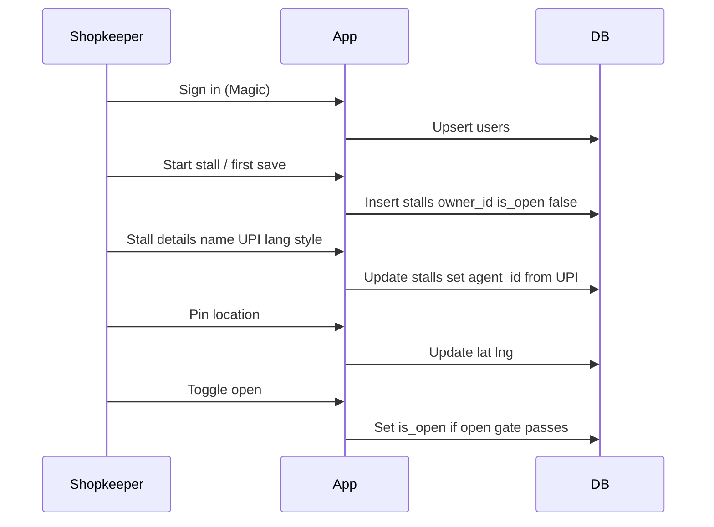

# Database — step 1: users and stalls

Shopkeeper registration foundation. Postgres holds people and their stall. This step covers **`users`** and **`stalls` only** — no menu items, bargains, or payments yet.

Migration: [`db/migrations/0001_users_stalls.sql`](../db/migrations/0001_users_stalls.sql). Apply with `npm run db:migrate` (needs `DATABASE_URL` in `.env.local`).

## Purpose

A shopkeeper signs in, starts a stall a piece at a time (details → pin → open), and that state has to survive reloads. Step 1 answers: who is the person, and what is their stall shell?

## Decisions

| Decision              | Choice                                                                                                                            |
| --------------------- | --------------------------------------------------------------------------------------------------------------------------------- |
| Store                 | Postgres                                                                                                                          |
| Stalls per shopkeeper | One (`stalls.owner_id` unique); drop uniqueness later if multi-stall is needed                                                    |
| Person key            | Magic-style issuer string as `users.id`, plus `email`                                                                             |
| Incomplete stalls     | Allowed; row can exist with empty name / no UPI / no pin                                                                          |
| Discoverable          | Only when `is_open` is true                                                                                                       |
| Agent address         | Nullable `agent_id` from UPI (`agent_` + first 10 hex of sha256(UPI)), unique when set — payout identity without building A2A yet |
| Menu / money          | Not in this step                                                                                                                  |

## Entity model

```mermaid
erDiagram
  users ||--o| stalls : owns
  users {
    text id PK
    text email
    timestamptz created_at
  }
  stalls {
    text id PK
    text owner_id UK_FK
    text name
    text lang
    text style
    text upi_id
    text upi_qr
    text agent_id UK
    float lat
    float lng
    boolean is_open
    timestamptz created_at
    timestamptz updated_at
  }
```

One user owns at most one stall. A stall always points at its owner.

## Tables

### `users`

One row per signed-in person. Upsert on sign-in.

| Column       | Type                                   | Notes                                      |
| ------------ | -------------------------------------- | ------------------------------------------ |
| `id`         | `text` PRIMARY KEY                     | Magic issuer (`did:ethr:0x…`)              |
| `email`      | `text` NOT NULL                        | Display / contact; updated on each sign-in |
| `created_at` | `timestamptz` NOT NULL DEFAULT `now()` | First seen                                 |

No Hedera, LP, or role columns in step 1. Buyers and shopkeepers share this table; owning a stall is what makes someone a shopkeeper.

### `stalls`

The shopkeeper's stall shell. Progressive setup: create empty and closed, then fill details, pin, then open.

| Column       | Type                                           | Notes                                              |
| ------------ | ---------------------------------------------- | -------------------------------------------------- |
| `id`         | `text` PRIMARY KEY                             | Stable id (`u-` + short uuid)                      |
| `owner_id`   | `text` NOT NULL UNIQUE REFERENCES `users (id)` | One stall per shopkeeper                           |
| `name`       | `text` NOT NULL DEFAULT `''`                   | Empty until the shop names it                      |
| `lang`       | `text` NOT NULL                                | Stall speak language code (e.g. `en`, `hi`)        |
| `style`      | `text` NOT NULL DEFAULT `'friendly'`           | `friendly` or `firm` — agent tone later            |
| `upi_id`     | `text`                                         | VPA (`name@bank`); required before open            |
| `upi_qr`     | `text`                                         | Scanned `upi://` payload when it matches `upi_id`  |
| `agent_id`   | `text` UNIQUE                                  | Set when UPI is set; null while draft              |
| `lat`        | `double precision`                             | Null until pin; `CHECK (lat BETWEEN -90 AND 90)`   |
| `lng`        | `double precision`                             | Null until pin; `CHECK (lng BETWEEN -180 AND 180)` |
| `is_open`    | `boolean` NOT NULL DEFAULT `false`             | Closed / incomplete stalls are not discoverable    |
| `created_at` | `timestamptz` NOT NULL DEFAULT `now()`         |                                                    |
| `updated_at` | `timestamptz` NOT NULL DEFAULT `now()`         | Bump on every save                                 |

#### Constraints and indexes

- `owner_id` **UNIQUE** — one stall per user.
- `agent_id` **UNIQUE** when set — one UPI ID → one agent address → one owner. Changing UPI recomputes `agent_id`; collision means another stall already takes pay at that VPA.
- `style IN ('friendly', 'firm')`.
- Lat/lng range CHECKs as above.
- Index for later discovery (not used until find exists): open + pinned stalls, e.g. partial index on `(is_open)` where lat/lng are present.

#### Agent id formula

When `upi_id` is set:

```text
agent_id = 'agent_' || left(encode(sha256(convert_to(upi_id, 'UTF8')), 'hex'), 10)
```

Clear `upi_id` → clear `agent_id`. Do not invent an agent id for an unnamed draft.

## Open gate

App rule (enforce in writes; document here so UI and API stay aligned):

`is_open` may be **true** only if all of:

1. `name <> ''`
2. `upi_id IS NOT NULL`
3. `lat IS NOT NULL` AND `lng IS NOT NULL`

Clearing name or UPI must force `is_open = false`. Pin alone is not enough to open.

## Registration lifecycle



| Step | Action        | Tables                                                                   |
| ---- | ------------- | ------------------------------------------------------------------------ |
| 1    | Sign in       | Upsert `users`                                                           |
| 2    | Start stall   | Insert `stalls` for `owner_id`, `is_open = false`, empty `name`          |
| 3    | Stall details | Update `name`, `upi_id`, `upi_qr`, `lang`, `style`; recompute `agent_id` |
| 4    | Pin           | Set `lat`, `lng`                                                         |
| 5    | Open          | Set `is_open = true` only if open gate passes                            |

Menu items are **step 2** (a separate table). Do not put item name/price columns on `stalls`.

## Not in step 1

| Later                               | Why wait                                          |
| ----------------------------------- | ------------------------------------------------- |
| `stall_items` / menu                | What the stall sells, asking price, private floor |
| Bargains, offers, turns             | Negotiation                                       |
| Payments, deal locks, LP            | Money movement                                    |
| A2A task / hit tables               | Protocol persistence                              |
| Redis / KV                          | Short-lived cache and rate limits                 |
| Push subscriptions, Hedera accounts | Device alerts and crypto payout identity          |

## Applying the migration

```bash
cp .env.example .env.local   # set DATABASE_URL, SESSION_SECRET, Magic keys
npm run db:migrate
```

Open gate is enforced in shop server actions (`saveStallDetails`, `setStallOpen`), not only in SQL.
